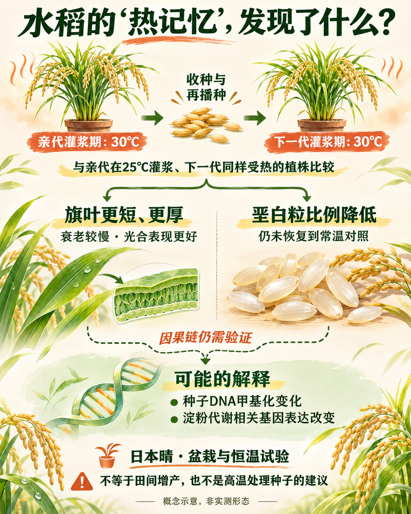
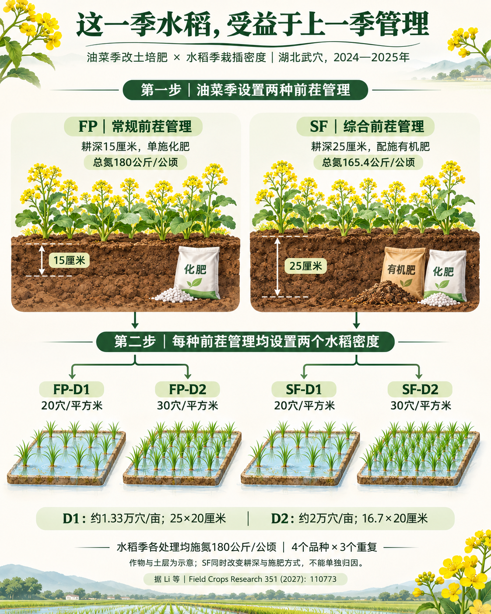
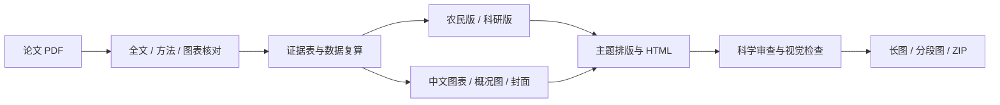

# 农业论文 → 中文公众号

**给 Agent 一篇农业论文 PDF，交付可读、有据、有图的公众号文章。**

`agri-paper-wechat` 是面向农业科学传播的 Codex Skill：同一篇论文分别面向农民和农业科研人员组织内容，核对数据，制作中文图表、全文概况图与封面，最后输出 HTML、长图和素材包。

它把“读论文—核证据—讲故事—做图—排版—检查”连接起来。**这是 Agent 工作流，不是把 PDF 拖进一个脚本就能离线完成写作的软件。**


## 一篇论文，两种讲法

| | 农民版 `farmers` | 科研版 `researchers` |
|---|---|---|
| 从哪里切入 | 农时、田间问题、农户决策 | 科学问题、研究设计、证据链 |
| 怎么写 | 解释术语、讲清比较对象、说明适用条件 | 保留处理、样本量、统计口径和机制边界 |
| 读完带走什么 | 哪些值得关注，哪些不能直接照搬 | 研究新增了什么证据，还缺什么验证 |
| 默认风格 | 绿色编号、浅色导语、作物插画 | 薄荷绿栏目、知识卡、蓝框亮点 |

默认同时生成两版，也可以只要其中一版。主题与读者类型分开设置：

- **`hgy`（默认）**：依据慧耕耘文章与参考 PDF 提炼的独立排版实现，强调阅读节奏与科学边界。非官方模板，不附带品牌授权。
- **`non-hgy`（非hgy）**：独立的橄榄绿编辑风格，参考 `gzh-design-skill` 的组件化与质量检查思路；并非其完整主题库。

## 最终交付什么

- **正文**：农民版 / 科研版、可编辑 Markdown、中文图注。
- **证据**：关键结论与原文页码、图表、分母、单位和统计范围对应的证据表。
- **图像**：核心图表中文化、表格数据重绘、全文概况图、横版封面。
- **网页**：可独立打开的单文件 HTML、内联样式的秀米候选导入 HTML。
- **长图**：整篇 PNG、按顺序编号的分段 PNG、渲染报告。
- **文件包**：图片、数据、绘图代码、检查记录与 ZIP。

每个核心部分配能支持论点的图；不为凑数量机械地给每一段塞图。数据图由 Python 绘制，生成式绘图只用于概念插画和封面。

## 效果示例

以下均为实际生成后整理的公开展示版。保留原创中文说明、插画与数据重绘，未分发原论文 PDF 或论文原图；原图位置以查阅提示替代，图号保留以便追溯。

| 主题 | 农民版 | 科研版 | 长图 |
|---|---|---|---|
| 水稻“热记忆”：亲代经历与下一代耐热表现 | [阅读正文](examples/rice-heat-memory/farmers/article.md) · [下载 HTML](examples/rice-heat-memory/farmers/preview.html) | [阅读正文](examples/rice-heat-memory/researchers/article.md) · [下载 HTML](examples/rice-heat-memory/researchers/preview.html) | [农民版](examples/rice-heat-memory/farmers/long-image/article-long.png) · [科研版](examples/rice-heat-memory/researchers/long-image/article-long.png) |
| 油菜—水稻轮作：前茬管理与后茬栽插密度 | [阅读正文](examples/rice-rotation/farmers/article.md) · [下载 HTML](examples/rice-rotation/farmers/preview.html) | [阅读正文](examples/rice-rotation/researchers/article.md) · [下载 HTML](examples/rice-rotation/researchers/preview.html) | [农民版](examples/rice-rotation/farmers/long-image/article-long.png) · [科研版](examples/rice-rotation/researchers/long-image/article-long.png) |

GitHub 文件页不会直接运行 HTML，下载后用浏览器打开。每份长图目录同时包含连续分段，可单独分享。

<table>
<tr><th>全文概况图</th><th>轮作试验设计图</th></tr>
<tr><td></td><td></td></tr>
</table>

## 安装

将本仓库放入 Codex 的个人 skills 目录，目录中应直接包含 `SKILL.md`。

```bash
# macOS / Linux；自定义 CODEX_HOME 时使用相应目录
git clone https://github.com/nengba-liu/agri-paper-wechat.git ~/.codex/skills/agri-paper-wechat
```

```powershell
# Windows PowerShell
git clone https://github.com/nengba-liu/agri-paper-wechat.git "$env:USERPROFILE/.codex/skills/agri-paper-wechat"
```

已有同名技能时先保留旧版本，不要强行覆盖。安装后重新打开会话，使客户端重新发现技能。

**运行环境**：建议 Python 3.11+。PDF 提取和默认长图使用 PyMuPDF，数据绘图使用 matplotlib；HTML 构建与静态审查只需 Python 标准库。中文数据图需要本机有中文字体。

```bash
python -m pip install -r requirements.txt
```

还需要 Agent 可读取 PDF 和本地文件，并具备图像生成工具来完成概况图、封面；没有图像工具时必须明确交付缺项，不能把占位图冒充成品。此技能不捆绑模型、账户、付费 API 或第三方私有技能。

## 怎么用

在 Codex 中附上 PDF，直接说：

> 用 $agri-paper-wechat 整理这篇论文，生成农民版和科研版，使用 hgy 主题。核心图表中文化，表格重绘成适合推文的图，附概况图、封面、HTML、整篇长图和素材包。

也可以只做一种：

> 用 $agri-paper-wechat 做科研版，非hgy主题，保留统计细节，最后导出长图。

> 用 $agri-paper-wechat 做农民版。重点解释这项措施在什么条件下有效，不能把单点试验写成普遍推荐。

默认使用 Python，不反复询问绘图软件；输出另建目录，不覆盖上一期。默认不操作秀米账户，不上传或发布文章。

## 工作流程



**数字先核对，再放进标题。** 例如，两年增产幅度明显不同，要检查是否为同年同处理基准、是否由四舍五入导致小差异，并保留年际差异；不能为让叙述整齐而把两年混成一个承诺。

**观测与解释分开。** 相关性、表达量变化和候选机制不自动等于因果；受控环境的发现不自动等于田间增产方案。

## 重建示例与导出长图

脚本用于装配已经核实的文章数据。输入结构见 [article.json 规范](references/article-schema.md)。

```bash
# 从已提供的示例重建 HTML、图文素材包和长图
python scripts/build_article.py examples/rice-heat-memory/farmers.json --out jobs/demo-farmers --theme hgy --long-image

# 换成非hgy主题；请选择新的输出目录
python scripts/build_article.py examples/rice-heat-memory/researchers.json --out jobs/demo-researchers --theme non-hgy --long-image

# 对已有单文件 HTML 单独导出长图
python scripts/render_long_image.py --input jobs/demo-farmers/预览_单文件.html --out jobs/demo-long --width 430 --scale 2 --segment-height 2400
```

默认长图宽 **860 像素**（430 逻辑宽度 × 2）。同时输出整篇与分段；超过整篇的像素/高度预算时，只输出覆盖全文的分段，报告会记录整篇缺省。分段为连续切片，可能在段落或图中间切开，适合接续阅读，不是重新排版的分页卡片。

默认使用 **PyMuPDF 离线重排**，不需要浏览器；它支持的 CSS 与浏览器不同，圆角、边框和部分间距可能变化。若要按照浏览器 HTML 渲染，安装可选依赖：

```bash
npm install
npx playwright install chromium
python scripts/build_article.py examples/rice-heat-memory/farmers.json --out jobs/demo-browser --long-image --long-backend browser
```

两种后端均不需要登录个人浏览器，也不下载远程图片。详细参数和验收要求见 [长图导出说明](references/long-image.md)。

## 产物目录

```text
农民版/
├── 预览_单文件.html      # 图片嵌入，可离线独立打开
├── 秀米导入.html         # 内联正文，候选导入文件
├── 正文.md
├── 中文图注.txt
├── article.json
├── images/              # 封面、概况图、中文图表
├── long-image/
│   ├── article-long.png # 尺寸预算内输出
│   ├── article-part-01.png
│   └── render-report.json
├── evidence.csv
├── data/
├── 检查报告.json
└── 导入说明.txt
农民版.zip
```

实际数据与代码附件由本次任务提供；构建器不会凭空补齐缺失的证据表或绘图代码。浏览器后端的分段命名为 `segment-01.png`。

## 关于秀米

本包生成内联样式正文和完整本地预览，**不承诺每个秀米账户都支持直接导入 HTML 或保留 base64 图片**。当前示例未完成秀米实机导入验证。

如平台过滤图片，上传 `images/` 素材后按 `asset-map.json` 替换；有合法 HTTPS 图片地址时，可通过 `--image-map` 重建。预览页的复制按钮提供图文复制入口，粘贴后仍须检查图片、字号和图注。静态检查通过不等于平台实测通过。

## 验证与维护

```bash
python -m unittest discover -s scripts -p "test_*.py"
python scripts/audit_html.py jobs/demo-farmers/秀米导入.html

# 可选浏览器导出测试；需要先安装 Playwright 浏览器
npm run test:long-image
```

当前发布准备阶段：Python 的 **13 项行为测试通过**，四份示例已实际导出长图。浏览器测试在开发环境被系统进程权限拦截，尚未在该环境通过完整运行；不要将它视为已完成的平台验证。

更多规则：[证据与图表](references/evidence-figures.md) · [读者与主题](references/audience-themes.md) · [hgy 样式](references/hgy-style.md) · [视觉提示词](references/visual-prompts.md) · [参考记录](references/sources.md)。

## 致谢与许可

- 感谢慧耕耘公开文章提供科学传播与排版参考。本仓库为独立实现，不代表官方出品，不复制署名、二维码和参考稿作者身份。
- 参考 [isjiamu/gzh-design-skill](https://github.com/isjiamu/gzh-design-skill) 的排版工程思路。该项目声明 AGPL-3.0；本仓库未包含其源码或模板，后续若引入须遵守相应许可证。
- 原论文及第三方素材保留原权利；公开示例提供 DOI 与来源，不附原文 PDF。

原创代码与技能说明采用 [MIT 许可证](LICENSE)。示例文章、插画、数据图与第三方内容的范围见 [素材与来源声明](NOTICE.md)，不应将代码许可证理解为对原论文素材的重新授权。
