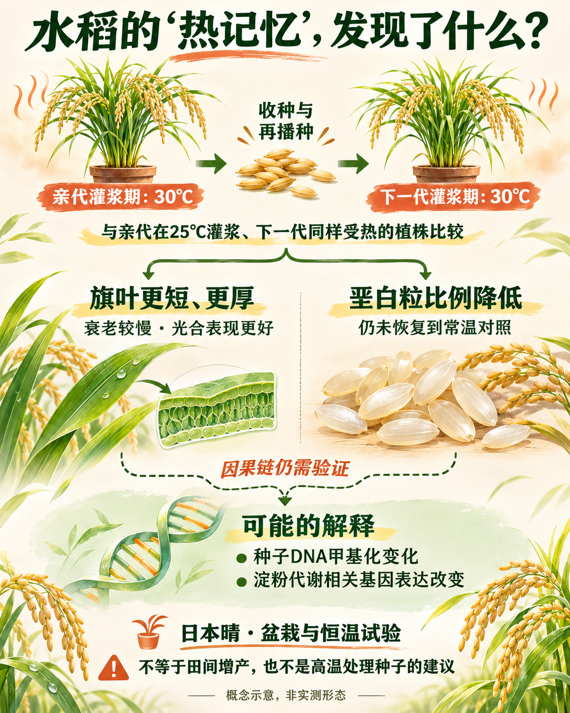
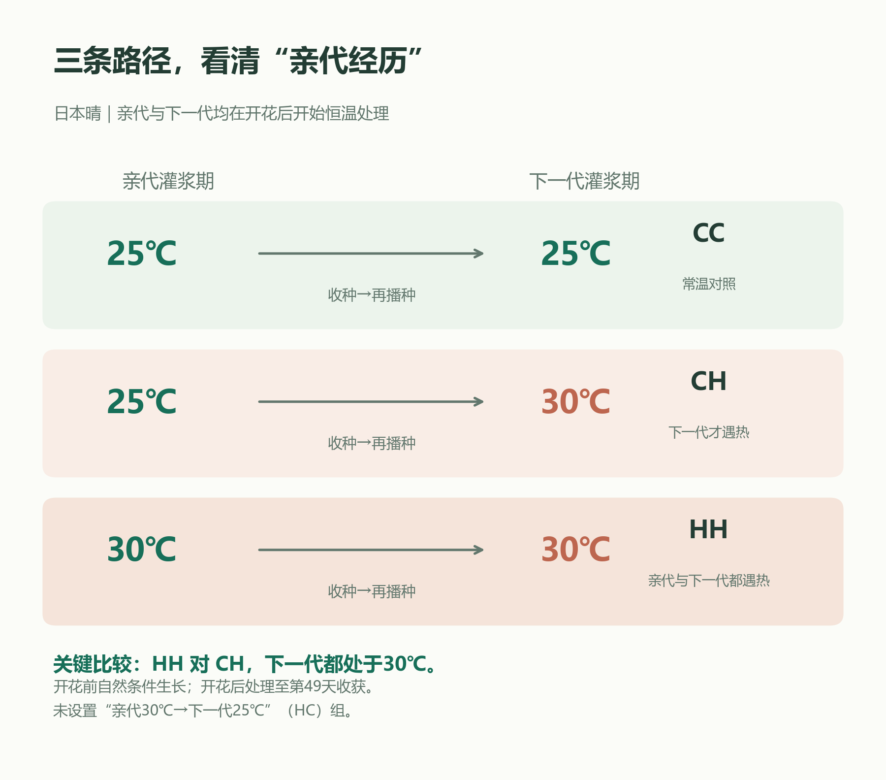
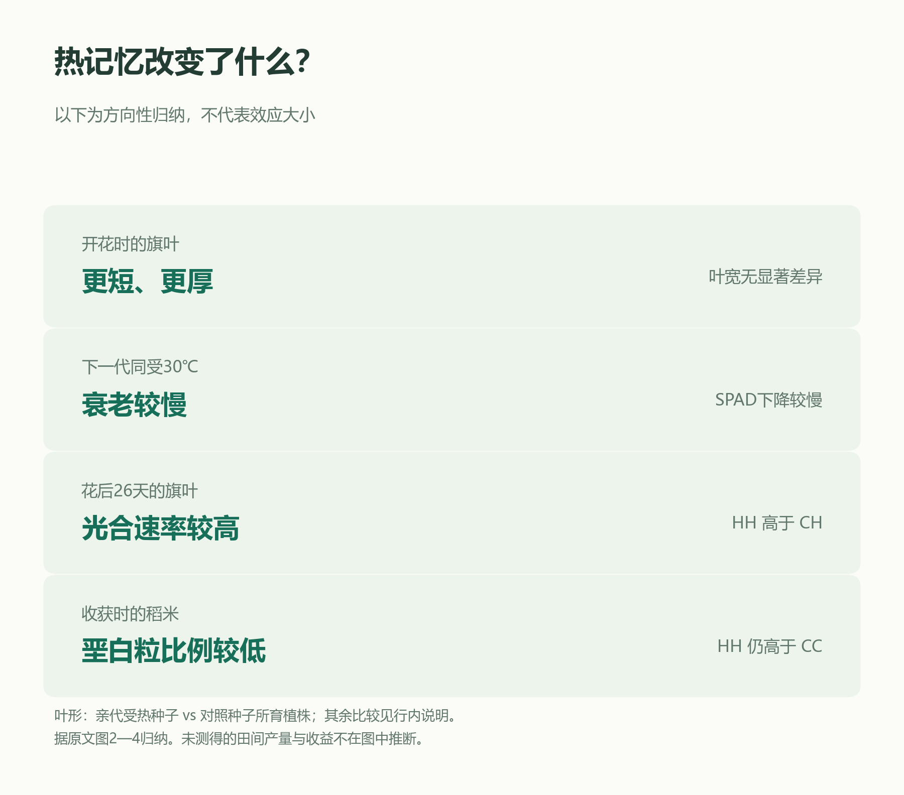
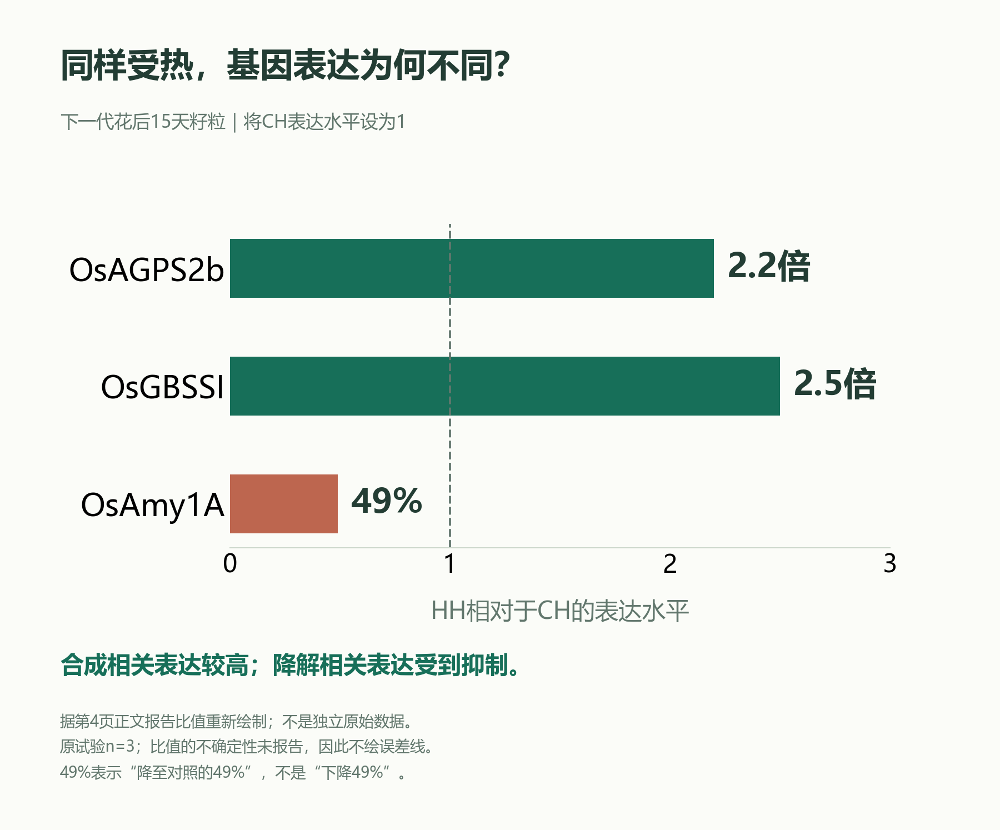
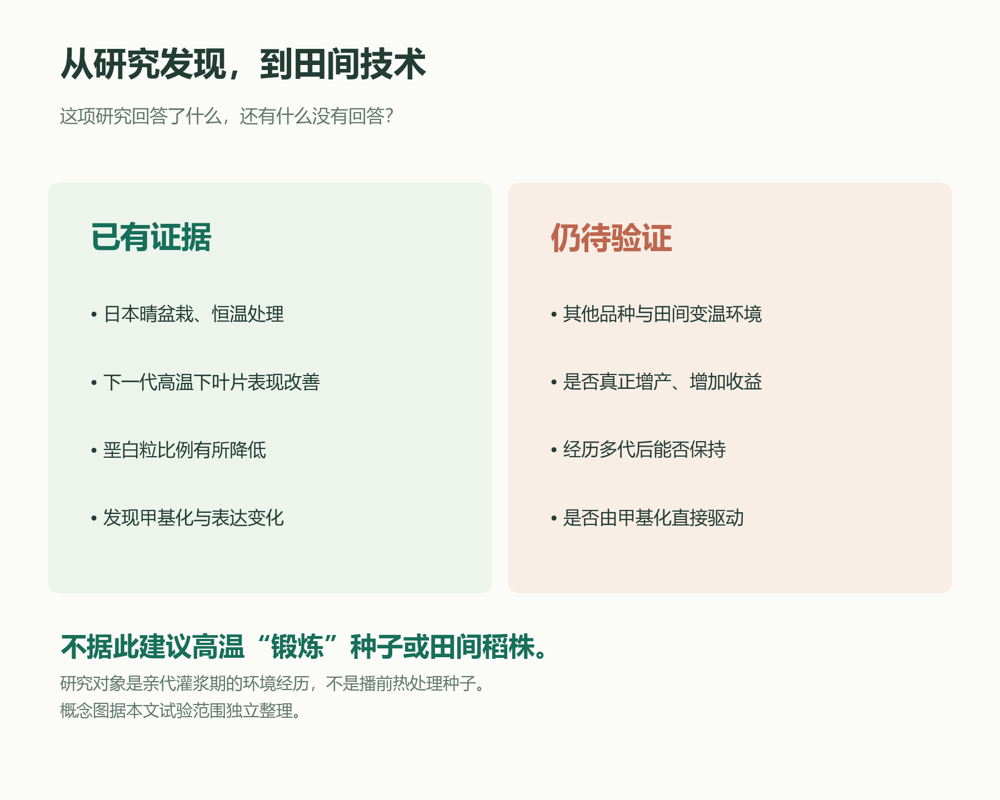

# 水稻也有“热记忆”？上一代受过热，下一代会怎样

从旗叶到米粒，读懂一项关于高温与种子的研究

水稻灌浆时遇上高温，种植户担心的不只是收多少粮，还包括米粒能不能长得饱满、外观是否通透。米粒中出现粉白、不透明的部分，被称为垩白，也是评价稻米外观品质时常关注的性状。
但科学家又问了一个更长远的问题：这一季水稻经历的高温，会不会通过留下的种子，影响下一季水稻面对高温时的表现？一项发表于《Scientific Reports》的研究发现，**在特定试验条件下，上一代受热的经历，确实与下一代更好的耐热表现相联系。**这里的“热记忆”，值得了解，也需要读清适用范围。

亲代30℃灌浆来源的下一代，与亲代25℃来源的下一代比较，两者均在30℃下灌浆。叶片与垩白变化是观测结果；甲基化与基因表达的机制联系仍待验证。米粒、叶片和盆栽为AI辅助示意，非实测形态。据本文独立整理。

## 先看清：受热的是哪一代？

研究人员使用水稻品种“日本晴”，先让亲代在自然条件下生长，开花后分别转入25℃和30℃的恒温环境，直到花后49天收种。随后把两类种子播下，再比较它们长成的下一代。

下一代同样先在自然条件下生长，开花后分成三组：两代都在25℃灌浆，记作CC；亲代25℃、下一代30℃，记作CH；两代都在30℃灌浆，记作HH。**最关键的比较是HH与CH：下一代都遇到了30℃，区别在于种子形成时亲代是否受过热。**

C=25℃，H=30℃；首字母为亲代，次字母为下一代。两代均在开花后开始处理，花后49天收获；开花前自然条件培养。HH与CH的下一代温度相同，亲代经历不同。未设置HC组。据原文实际图1与第6页方法独立绘制。

这样设计，才能把“这一代有没有遇热”和“上一代是否有受热经历”区分开来。它研究的是种子形成过程中留下的影响，不能等同于播种前用热水浸种，也不是短时间把干种子加热。

还要留意试验里的“30℃”：这是开花后的恒温处理，有明确的持续时间和湿度条件。田间天气有昼夜起伏，不能只看到一个温度数字，就把日最高气温与这个处理直接画等号。

## 最直接的结果：米粒垩白有所减轻

收获后，研究人员检查了各组籽粒。与常温对照CC相比，下一代才遇热的CH组垩白粒比例更高；而亲代、下一代都遇热的HH组，垩白粒比例低于CH。这说明，在同样的高温环境下，亲代经历与下一代的籽粒外观品质有关。

> 原论文图表：公开示例不分发该论文原图。相应结果与统计解释请结合文末 DOI 链接查阅原文；本文保留独立绘制的中文说明与数据图。

这张图要看柱子的总高度，而不能只看某一种颜色。三组柱顶标着不同字母，表示总垩白粒比例存在统计上的显著差异。**HH虽比CH好，却仍不如CC：热记忆减轻了影响，并没有让高温伤害消失。**

“垩白粒比例”说的是有这类外观问题的米粒占多少，不是每粒米白色部分占多大，更不是亩产。论文没有用田间产量或种植收益证明这项效应，所以不能把“米粒外观改善”换写成“必然增产增收”。

## 变化不只在米粒：旗叶也不一样了

旗叶，就是水稻最上面、靠近稻穗的那片叶。研究发现，由亲代受热种子长出的植株，旗叶更短、更厚，叶宽则没有显著变化。到了下一代高温灌浆时，HH组旗叶衰老较慢，花后26天测得的光合速率也高于CH组。

旗叶形态比较的是受热种子与对照种子所育植株；生理与品质比较主要为HH对CH。叶宽未出现显著差异；HH垩白粒比例仍高于CC。仅归纳方向，不表示效应量，统计细节见原文图2—4。

可以把叶片理解为制造有机物的“生产车间”。叶片在高温下维持较好的工作状态，可能有利于籽粒发育；但这不是说叶片越厚越好，也不能据此认定“厚叶”就是垩白减少的唯一原因。叶片变化与籽粒变化同时出现，背后的联系还需要进一步试验。

这里还有一个细节：研究中的光合测定针对旗叶，而不是整片稻田的总光合作用。单叶表现较好，距离群体增产还有穗数、结实和灌浆等环节需要核实。

## 所谓“记忆”，可能留在什么地方？

水稻没有人的大脑。“记忆”在这里是一个科学比喻，指过去的环境经历可能留下持续影响。研究人员追踪到的线索之一，是种子DNA上的甲基化标记——它可以参与调节基因的活动，而不是把DNA字母顺序改写成新的品种。

研究观察到，亲代受热后，种子里部分淀粉合成相关基因的启动子甲基化水平降低，部分淀粉降解相关基因则升高。等到下一代也在高温中灌浆，两类基因的表达出现了相应变化。

HH相对于CH：OsAGPS2b表达为2.2倍，OsGBSSI为2.5倍，OsAmy1A降至49%。数值转录自PDF第4页正文，对应实际图6；均为下一代花后15天籽粒，原试验n=3。虚线=CH基准1；比值不确定性未单独报告，故不补画误差线。此图不是酶活性、淀粉含量或增产幅度图。

例如，与CH相比，HH籽粒中两个淀粉合成相关基因的表达分别为2.2倍和2.5倍；一个淀粉降解相关基因的表达降至49%。这些是**基因表达的相对数值**，不能读成淀粉多了同样倍数，更不能读成产量提高同样幅度。

这条线索像是“合成一侧更活跃、降解一侧受到抑制”，与垩白减少的方向相呼应。不过，研究还没有直接改变这些甲基化标记，再观察耐热表现是否随之改变。因此，目前更合适的说法是“找到可能的机制”，而不是已经解开全部原因。

## 这项发现，今天能不能直接用在田里？

目前还不能把它当成成熟的栽培技术。研究对象只有日本晴一个品种，而且是在盆栽、恒温环境中完成的；试验还去除了分蘖、保留主茎，与生产上完整的水稻群体不同。其他品种、不同热浪过程，以及田间肥水条件下会怎样，都需要验证。

本文研究日本晴在受控条件下的下一代表现；未验证多品种田间产量、经济收益或跨多个无胁迫世代的稳定保持。图为研究范围归纳，不是农事操作流程。

对种植户而言，这项研究带来的实用认识是：**一批种子的形成环境，可能影响它后来的表现。**比较种子或关注试验示范时，除了品种名称，也可以留意制种环境、种子质量和当地验证条件，不能把某次热害经历当成种子质量更好的凭据。

如果今后有相关技术进入示范，值得追问的应是：用了什么品种？在真实田间验证了多少季？改善的是垩白、产量，还是两者兼有？亲代受热的损失和后续收益是否一并计算？这些答案，比“有热记忆”四个字更能帮助生产决策。

> 读到这里，请记住：这不是建议把种子加热，也不是建议让留种田故意受高温。研究揭示了一种值得追踪的生物学现象；实际管理仍应依据当地品种、气象条件和已经验证的技术。

一粒种子的故事，可能从上一代灌浆时就已经开始。理解水稻的“热记忆”，让我们多了一条探索耐热机制的线索；能否把这条线索变成可靠的生产办法，还要靠后续田间证据。

## 论文与图源
Suriyasak C., Kawaguchi R., Matsumoto R., Sawada Y., Nong H. T., Hamaoka N., Ishibashi Y. Adaptive memory induced by heat stress during grain filling enhances subsequent thermotolerance in rice (Oryza sativa L.). Scientific Reports 15, 14135 (2025). https://doi.org/10.1038/s41598-025-99146-x

公开展示版：本文依据所引论文独立撰写，保留原创中文插画、示意图与据公开结果重绘的数据图；不附论文PDF及原论文图像。封面与概况图由AI辅助生成。数据事实与原作者结论的权利不因本仓库许可证改变。此示例用于展示科学传播流程，不构成通用农事处方。