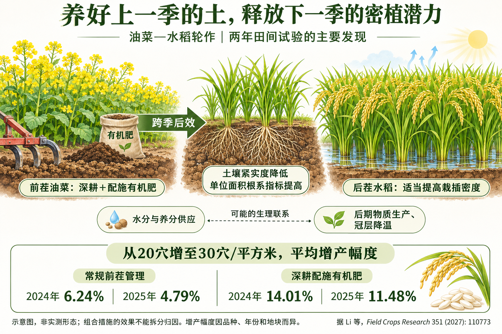
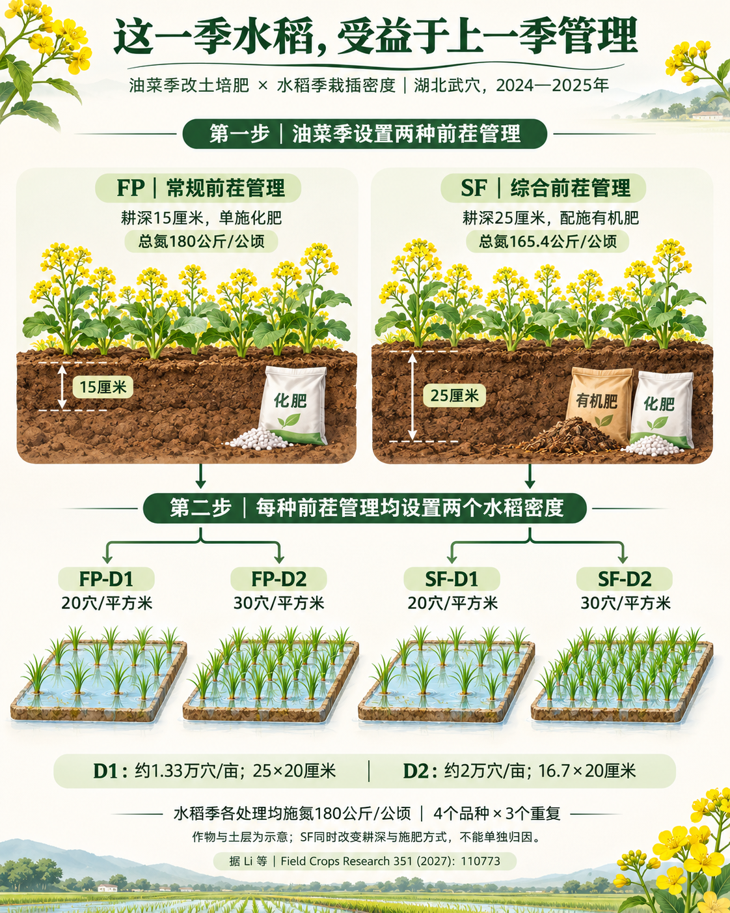
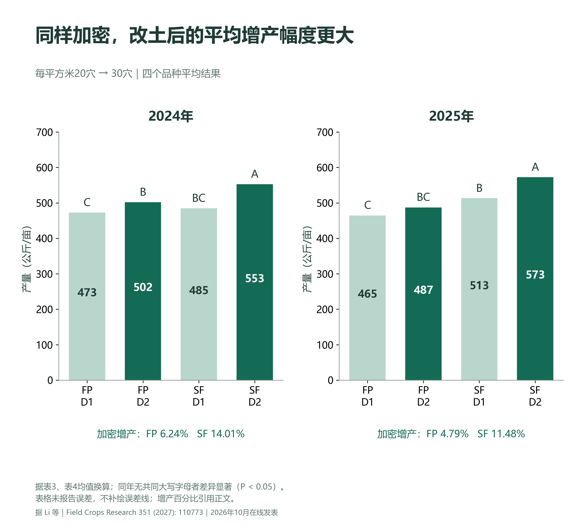
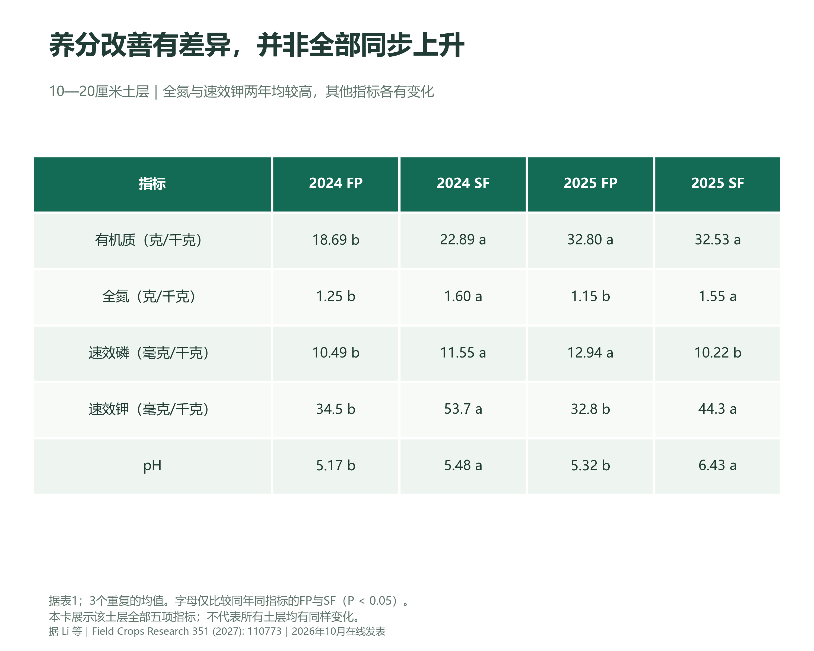
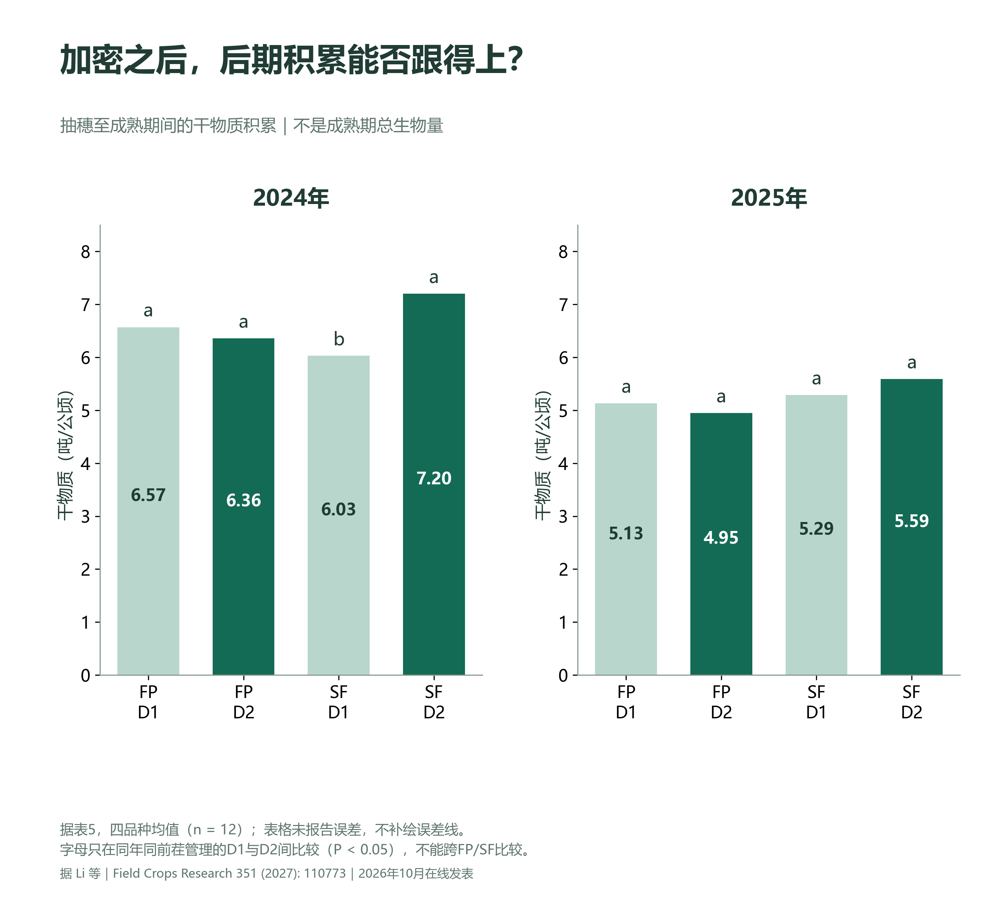

# 水稻想多收粮，功夫要做在上一季？

油菜—水稻轮作｜湖北武穴两年田间试验

上一期，我们聊到一个看似矛盾的现象：水稻适当插密一些，即使单穗表现有所下降，整田仍可能依靠更多有效穗获得增产。
但问题随之而来：同样增加栽插密度，为什么有的田增产明显，有的田效果有限？除了品种和肥水，答案可能还藏在脚下的土壤里，甚至要追溯到上一季作物。
华中农业大学等单位的一项新研究，把目光放在长江中下游常见的油菜—水稻轮作体系。研究发现：前一季油菜采用深耕配合有机肥的管理方式，能够改善后茬水稻的生长条件，而且在这种条件下，适当密植获得的增产收益更大。
这篇论文于2026年10月在线发表，编入《Field Crops Research》2027年第351卷。它带来的启发是：水稻高产，既要安排好地上的群体，也要给地下根系创造条件。 ==群体安排要与土壤条件一起考虑。==

概况图｜前茬管理对后茬水稻的影响。虚线表示可能的生理联系；百分比为同年前茬管理条件下，加密相对常规密度的平均增产幅度。

## 这次改变的，是“上一季”的管理

研究人员在湖北武穴开展了2024、2025连续两年的田间试验。前茬油菜设置两种管理方式：常规处理FP采用15厘米浅耕、单施化肥；综合处理SF采用25厘米深耕，并配施有机肥。

到了水稻季，再分别设置每平方米20穴和30穴两个栽插密度，约相当于每亩1.33万穴和2万穴。四个供试品种涵盖常规籼稻和杂交籼稻，每个组合设置3个重复。

图1｜前茬管理与后茬密度的组合试验。FP为油菜季15厘米浅耕、单施化肥；SF为油菜季25厘米深耕并配施有机肥。后茬水稻D1、D2分别为20穴/平方米和30穴/平方米。水稻季各处理施氮量相同。此图为依据试验方法制作的示意图。

这里有两个细节很重要。第一，深耕和有机肥处理发生在油菜季，研究考察的是它们对后茬水稻的“后效”。第二，SF是一个组合方案，同时改变了耕深和施肥方式，并不是单独检验深耕或有机肥的作用。

油菜季FP的总氮投入为180公斤/公顷，SF计入有机肥带入的氮后为165.4公斤/公顷；而后茬水稻季，各处理均施氮180公斤/公顷。因此，不能把本研究解释成“给水稻多施肥，所以增产”。

## 同样多插一些，增产幅度为什么不同？

先看最直接的结果。在两个密度、四个品种的平均水平上，与FP相比，前茬采用SF后，水稻产量在2024年提高6.41%，在2025年提高14.07%。

更值得关注的是密度的反应。从每平方米20穴增加到30穴，常规前茬管理下，两年的平均增产幅度分别为6.24%和4.79%；综合前茬管理下，则分别达到14.01%和11.48%。

也就是说，同样增加50%的栽插穴数，在前茬综合管理条件下，水稻平均增产的幅度更大。两年的结果方向一致，统计分析也发现了前茬管理与栽插密度对产量的显著交互作用。

图2｜前茬综合管理下，增加水稻栽插密度的平均增产幅度更大。产量均值据论文表3、表4换算为公斤/亩；字母沿用原表的大写字母，比较同一年四种管理组合。表格未提供这些均值的标准差或标准误，本重绘图不添加误差线；带标准差的原论文图3另附。加密增产百分比直接引用论文正文，基于原始精度计算，与表格四舍五入值重算可能略有差别。

但这不意味着每个品种、每个年份都会如此。例如，2025年SF条件下，HHZ品种从D1加密到D2，产量由7.44降至7.26吨/公顷。群体平均增产，与某一品种必然增产，是两回事。

## 把土壤改善好，效果能延续到下一季

土壤不仅是支撑植株的“底座”，也是根系获取水分、养分和生长空间的环境。研究人员发现，前茬采取SF处理后，在后茬水稻季仍能观察到较低的土壤紧实度。

相较FP，SF在2024年测得的紧实度降幅为7.66%—27.35%；连续两年处理后，2025年的降幅为25.57%—63.92%。这些数字对应不同土层，不能理解为整块田统一降低了同一个比例。

> 原论文图表：公开示例不分发该论文原图。相应结果与统计解释请结合文末 DOI 链接查阅原文；本文保留独立绘制的中文说明与数据图。

养分的变化也不是“每个土层、每个指标都提高”。例如，在10—20厘米土层，SF的全氮和速效钾在两年均高于FP；但同一土层的速效磷在2025年反而较低。

图4｜10—20厘米土层的养分响应具有差异。数据选自论文表1，以两年均出现全氮和速效钾提高的土层作为说明，同时保留该土层全部五项指标，展示并非所有养分同步上升。数值为3个重复的均值；同年同指标、同土层内，不同字母表示FP与SF差异显著（P<0.05）。表中未给出误差，未另行估算。

这提示我们，“改良土壤”需要看具体土层和指标，不能仅用一句“肥力全面提高”概括。

## 地下根系更发达，地上群体才更有支撑

密植会增加单位面积植株数量，也会增强对水分、养分和生长空间的竞争。土壤条件改善后，能否为更大的地上群体提供支撑？

研究发现，与FP相比，SF在两年平均水平上的单位面积总根长、根表面积和根体积，分别提高54.98%、49.60%和50.52%。这些根系指标与产量、植株生物量和吸氮量呈显著正相关。

> 原论文图表：公开示例不分发该论文原图。相应结果与统计解释请结合文末 DOI 链接查阅原文；本文保留独立绘制的中文说明与数据图。

注意，这里的“根系更多”指单位面积的测定结果，不能直接改写成“每株水稻的根都增加了50%”，也不能据此断言根系扎深了多少厘米。

这些发现支持一个解释：改善地下生长条件，有助于让增加的地上群体获得更多资源。但相关关系本身，也不能证明根系是增产的唯一原因。

## 密植以后，后期还能不能持续积累干物质？

增产不能只看前期苗多不多，还要看抽穗后能不能继续积累干物质。所谓干物质，就是除去水分后，植株通过生长积累起来的物质。

常规前茬管理FP下，从D1加密到D2，抽穗至成熟期间的干物质积累在两年分别略降3.19%和3.38%；综合管理SF下，则分别增加19.30%和5.62%。

图6｜加密后，抽穗后干物质积累的变化因前茬管理而异。据论文表5重绘，显示抽穗至成熟期间积累的干物质，不是成熟期总生物量。均值综合四品种（n=12）；字母仅比较同年前茬管理相同的D1与D2。2024年SF下两密度差异显著；2025年SF下虽数值增加，两密度共享字母，差异未达显著。表格未提供误差，图中不增添误差线。

这说明，改善土壤后，密植不仅可能增加前期群体，还可能改善后期的物质生产。但数值增加并不都意味着统计上显著，不能把两个年份讲成完全相同的结果。

研究还发现一个有趣现象：在2025年、每平方米30穴的条件下，SF的冠层温度比FP平均低1.06℃，同时根系伤流、气孔导度和蒸腾速率更高。

> 原论文图表：公开示例不分发该论文原图。相应结果与统计解释请结合文末 DOI 链接查阅原文；本文保留独立绘制的中文说明与数据图。

蒸腾会带走热量，研究者据此提出：较好的根系与水分供应，可能通过增强蒸腾帮助冠层降温，并与较好的籽粒充实表现有关。不过，这组测定不能证明所有密度、全年各时期都能降低1.06℃，也不是专门的控温因果试验。

## 对生产的启发：把“养地”和“密植”放进同一张计划表

这项研究最有价值的地方，是把前茬管理和后茬栽培联系了起来。

第一，轮作田要算跨季的账。油菜季的耕作和施肥，不仅关系到当季作物，也可能影响下一季水稻。评估管理方案时，应把前后茬的投入和产出一起考虑。

第二，密度调整要和土壤条件一起看。研究比较的是两个密度水平，并没有找出所有地区通用的“最佳密度”；更不能据此认定30穴/平方米就是普遍上限或最优值。

第三，把试验参数当作对照依据，而非统一处方。研究中的25厘米耕深、有机肥用量和施肥安排，都有具体土壤、轮作与作业条件。结合当地农技意见做小面积对照，更有助于判断本地效果。

第四，增产还需要算成本。深耕、肥料运输和作业都会产生投入，本文未给出完整的经济效益分析，因此不能从“产量增加”直接推断“利润一定更高”。

上一期告诉我们，水稻高产需要协调单株与群体；这一期进一步提醒我们，群体之下，还有决定资源供应的土壤和根系。

要让密植的潜力发挥出来，不能只问“一亩田多插多少穴”，也要问：这块田的土壤，能不能支撑更多稻株生长？

## 论文与图源
Li Y., Gao Y., Chang S., et al. Field Crops Research 351 (2027): 110773. 2026年10月26日在线发表。 https://doi.org/10.1016/j.fcr.2026.110773

公开展示版：本文依据所引论文独立撰写，保留原创中文插画、示意图与据公开结果重绘的数据图；不附论文PDF及原论文图像。封面与概况图由AI辅助生成。数据事实与原作者结论的权利不因本仓库许可证改变。此示例用于展示科学传播流程，不构成通用农事处方。