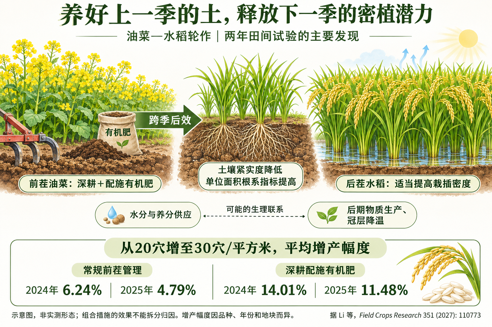
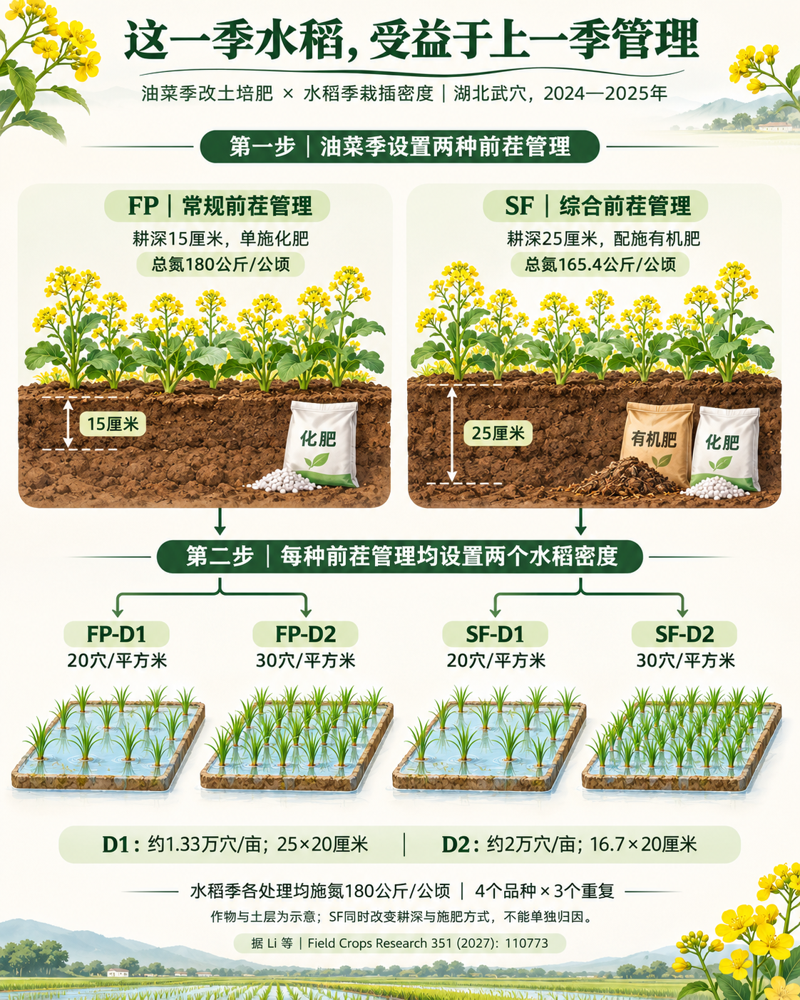
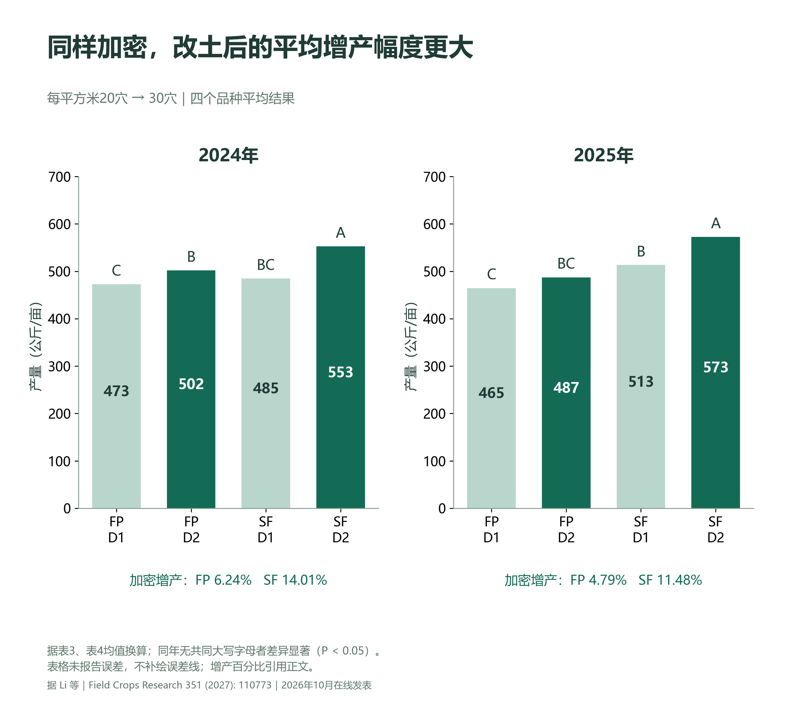

# FCR｜前茬改土培肥，如何改变后茬水稻的密植响应？

论文解读 · 油菜—水稻轮作 · 两年田间证据

文章标题：Residual effects of deep tillage and fertilization practices in the preceding rapeseed season on subsequent rice yield are greater under high transplanting density

中文标题：高栽插密度下，前茬油菜季深耕与施肥措施对后茬水稻产量的残效更大

发表期刊：Field Crops Research, 351 (2027): 110773

在线日期：2026年10月26日

本页展示慧耕耘科研版的栏目和版式，内容沿用已制作的论文解读；完整来源见文末。

## 研究背景

栽插密度增加后，水稻群体对地下资源的需求也会改变。前茬耕作与施肥形成的土壤差异，能否延续至后茬，并改变水稻对密植的响应？该研究将跨季管理与群体调控放在同一试验中比较。

概况图｜前茬管理对后茬水稻的影响。虚线表示可能的生理联系；百分比为同年前茬管理条件下，加密相对常规密度的平均增产幅度。

## 研究方法

湖北武穴2024—2025年田间试验。油菜季FP采用15厘米浅耕、单施化肥；SF采用25厘米深耕并配施有机肥。后茬设置20和30穴/平方米两个密度，4个品种、3个重复。水稻季各处理施氮相同。

图1｜前茬管理与后茬密度的组合试验。FP为油菜季15厘米浅耕、单施化肥；SF为油菜季25厘米深耕并配施有机肥。后茬水稻D1、D2分别为20穴/平方米和30穴/平方米。水稻季各处理施氮量相同。此图为依据试验方法制作的示意图。

## 主要结果

跨密度与品种平均，SF相对FP增产6.41%（2024）和14.07%（2025）。依据表格四舍五入均值复算约为6.43%与14.08%，与正文基本相容。表2显示年份×耕作施肥方式对产量的交互作用显著。

图2｜前茬综合管理下，增加水稻栽插密度的平均增产幅度更大。产量均值据论文表3、表4换算为公斤/亩；字母沿用原表的大写字母，比较同一年四种管理组合。表格未提供这些均值的标准差或标准误，本重绘图不添加误差线；带标准差的原论文图3另附。加密增产百分比直接引用论文正文，基于原始精度计算，与表格四舍五入值重算可能略有差别。

> 比较口径：SF与FP的主效应，不等于D2与D1的密植效应。两种前茬条件下分别计算加密收益，才能讨论密度响应。

单位地面面积根长、根表面积与根体积在SF下较高，并与产量、吸氮及生物量相关。形态指标不能解释为每株根系同幅增加，也不能直接推断根深。

> 原论文图表：公开示例不分发该论文原图。相应结果与统计解释请结合文末 DOI 链接查阅原文；本文保留独立绘制的中文说明与数据图。

2025年高密度抽穗期SF冠层温度平均低1.06℃。蒸腾与水分供应是合理解释，但试验没有独立操纵冠层温度来验证其对产量的因果贡献。

> 原论文图表：公开示例不分发该论文原图。相应结果与统计解释请结合文末 DOI 链接查阅原文；本文保留独立绘制的中文说明与数据图。

## 未来展望

> 可检验的问题：可考虑耕深×有机肥的独立因子设计，结合多年多点与不同土壤条件，检验根系变化能否解释密植收益的环境依赖性。以上为后续研究建议，不是本论文已完成的试验。

研究比较两个密度，未定位连续密度响应的最优点；亦缺少完整成本分析。科研解读应保留这些外推边界。

## 知识卡片

**前茬残效：**前一季管理造成的影响，在后一季仍能观测到。本研究考察油菜季管理对后茬水稻的影响。

**交互作用：**一种管理措施的效果随另一种因素的水平而变化；应查看统计检验与具体比较，不能只凭两根柱子的差异判断。

**单位面积根系指标：**以地面面积为分母汇总根长、表面积或体积，不能直接解释为每株水稻根系同幅增加。

**组合处理：**SF同时改变耕深和施肥方式，因此不能从这组比较中拆出深耕或有机肥各自的独立贡献。

## 文章亮点
- SF为耕深与施肥方式的组合，不能分别识别单因素效应。
- 年份×耕作施肥方式对产量的交互作用显著（P＜0.01）。
- 根系与冠层生理提供机制线索，尚不能构成排他的因果链。

## 论文与图源
Li Y., Gao Y., Chang S., et al. Field Crops Research 351 (2027): 110773. 2026年10月26日在线发表。 https://doi.org/10.1016/j.fcr.2026.110773

公开展示版：本文依据所引论文独立撰写，保留原创中文插画、示意图与据公开结果重绘的数据图；不附论文PDF及原论文图像。封面与概况图由AI辅助生成。数据事实与原作者结论的权利不因本仓库许可证改变。此示例用于展示科学传播流程，不构成通用农事处方。